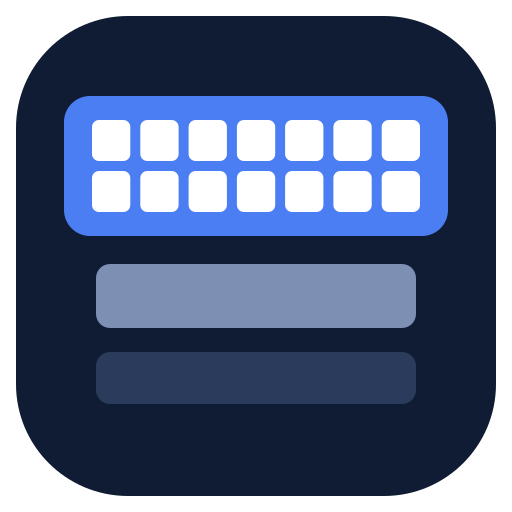
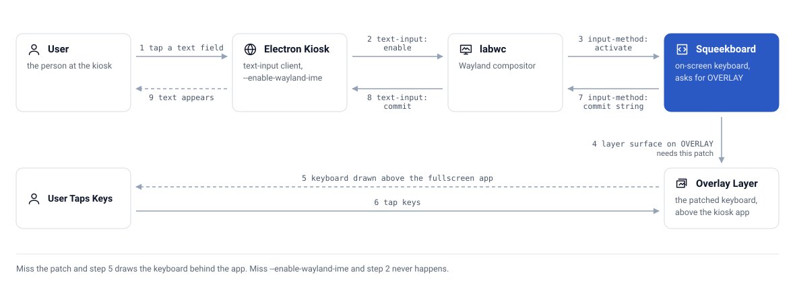
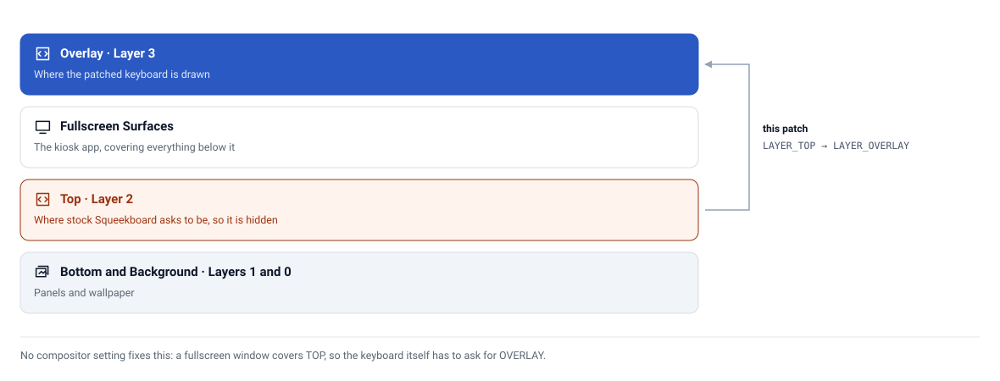

<div align="center">



# ⌨️ Squeekboard Overlay-Layer Patch

**Make the squeekboard on-screen keyboard show up above fullscreen apps on Raspberry Pi kiosks running labwc**


[](https://github.com/CaputoDavide93/Squeekboard-Overlay-Patch/actions/workflows/ci.yml)

</div>

---

## 🐛 Why it exists

You build a touch kiosk on a Raspberry Pi: a fullscreen Electron or Chromium app under labwc. You tap a text field and nothing appears. Squeekboard is running, receives input events and logs no errors. It is drawn behind the fullscreen window.

This repo is a one-line patch and a build script. They make squeekboard draw on the layer-shell `OVERLAY` layer, above fullscreen windows, and give you a `.deb` you can install in one build.

| | Stock squeekboard | This patch |
|---|---|---|
| Visible over a fullscreen kiosk app | No, drawn behind it | Yes, on the tested setup |
| Compositor configuration needed | None known to help | None |
| Rebuild from source | No | Yes, about 15 to 30 minutes on a Pi 5 |
| Survives `apt upgrade` | Yes | Only with `apt-mark hold squeekboard` |
| Draws above a lock screen | No | Can, on compositors that place it below `OVERLAY` |
| Package signed | Yes, by the distribution | No, you build it unsigned |

The one trade-off: `OVERLAY` is right for a locked-down kiosk and wrong for a phone or desktop, where a keyboard should not cover a lock screen. That is why this lives here as a patch and not as an upstream change. See [Why not upstream](#-why-not-upstream).

---

## 🚀 Quick Start

**You need:** a Raspberry Pi on Raspberry Pi OS (Debian Trixie, arm64) with labwc, `sudo`, and about 30 minutes for the build.

**Install in 3 steps:**

1. **Build the patched package** on the Pi:

   ```bash
   git clone https://github.com/CaputoDavide93/Squeekboard-Overlay-Patch.git
   cd Squeekboard-Overlay-Patch
   ./build.sh
   ```

2. **Install it** with the `dpkg -i` command the script prints, then keep apt from replacing it:

   ```bash
   sudo apt-mark hold squeekboard
   ```

3. **Restart the keyboard**, with the kiosk app started using `--enable-wayland-ime`:

   ```bash
   systemctl --user restart squeekboard
   ```

For the input-method environment, the systemd units and going back to stock, follow [docs/setup.md](docs/setup.md). There is no graphical interface here, so the repo has no screenshots.

---

## ✨ Features

| | Feature | What it does |
|---|---|---|
| 👀 | Keyboard above fullscreen | One hunk in `src/panel.c` moves squeekboard from `TOP` to `OVERLAY` |
| 🛠️ | One-command build | `build.sh` checks prerequisites, fetches the source, applies the patch and builds a `.deb` |
| 🛡️ | Safe to re-run | The script refuses a reversed or already-applied patch and checks the result selects `OVERLAY` |
| 📆 | Upstream watch | CI applies the patch to upstream and the Raspberry Pi fork every week, so drift shows before you hit it |
| 🗺️ | Drawn diagrams | Generated SVGs for the layer stack and the input-method chain, checked in CI |

---

## 🗺️ Architecture

<picture>
  <source media="(prefers-color-scheme: dark)" srcset="docs/assets/architecture-dark.svg">
  
</picture>

The patch is one link in the chain. Miss the patch and step 5 draws the keyboard where nobody can see it. Miss `--enable-wayland-ime` and step 2 never fires, so the keyboard never opens. The layer stack behind it:

<picture>
  <source media="(prefers-color-scheme: dark)" srcset="docs/assets/layers-dark.svg">
  
</picture>

The change itself:

```diff
-            "layer", ZWLR_LAYER_SHELL_V1_LAYER_TOP,
+            "layer", ZWLR_LAYER_SHELL_V1_LAYER_OVERLAY,
```

More in [docs/how-it-works.md](docs/how-it-works.md).

---

## ✅ Tested on

| Component | Version | Checked by |
|---|---|---|
| Raspberry Pi | 5 (arm64) | Author, by hand |
| OS | Raspberry Pi OS (Debian Trixie) | Author, by hand |
| Compositor | labwc 0.9.x | Author, by hand |
| squeekboard | 1.43.1-1+rpt1 | Author, by hand |
| Kiosk app | TouchKio (Electron) | Author, by hand |
| Patch applies to upstream `src/panel.c` | master | CI, weekly |
| Patch applies to Raspberry Pi fork `src/panel.c` | master | CI, weekly |

**Unverified:** Raspberry Pi 4, x86 machines, other wlroots compositors, other kiosk apps, Raspberry Pi OS releases before Trixie. If you try one, [tell me](#-contributing).

---

## ⚙️ Configuration

Rebuilding makes the keyboard visible. Three more pieces make it type, all in [docs/setup.md](docs/setup.md):

1. `GTK_IM_MODULE=wayland` and `QT_IM_MODULE=wayland` in the compositor environment.
2. `--enable-wayland-ime` on the Electron or Chromium app.
3. A `squeekboard` systemd user service that starts after the kiosk app.

`build.sh` takes two optional arguments: `./build.sh [SQUEEKBOARD_VERSION] [WORK_DIR]`. The defaults are `1.43.1-1+rpt1` and a fresh temporary directory. The repo reads no environment variables.

---

## 📁 Repo structure

```text
Squeekboard-Overlay-Patch/
├── .github/
│   ├── dependabot.yml          # 🔄 monthly GitHub Actions updates
│   └── workflows/ci.yml        # 🤖 patch drift, shellcheck, diagrams, docs
├── docs/
│   ├── assets/
│   │   ├── brand/              # 🎨 icon (SVG and 256 px PNG)
│   │   ├── architecture-*.svg  # 🗺️ generated diagram, light and dark
│   │   ├── layers-*.svg        # 🗺️ generated diagram, light and dark
│   │   └── social-preview.png  # 🖼️ 1280x640 card, uploaded by hand
│   ├── README.md               # 📚 index
│   ├── setup.md                # 🚀 step by step
│   ├── how-it-works.md         # 🧠 the stacking problem and the fix
│   ├── troubleshooting.md      # 🛠️ by symptom
│   └── faq.md                  # ❓ short answers
├── tools/
│   ├── check_docs.py           # 🧹 punctuation and index checks
│   ├── gen_diagram.py          # 🗺️ draws the diagrams (--check in CI)
│   └── brand/                  # 🖼️ vendored brand kit, renders the social card
├── AGENTS.md                   # 🤖 index for anyone changing the repo: checks, layout, rules
├── CONTRIBUTING.md             # 🤝 reports and diagnostics
├── LICENSE                     # 📄 GPLv3, matching upstream squeekboard
├── Makefile                    # ✅ make check
├── SECURITY.md                 # 🔒 reporting and OVERLAY caveats
├── build.sh                    # 🛠️ fetch, patch, build the .deb
├── llms.txt                    # 🤖 plain-text summary for search tools
├── overlay-layer.patch         # 🩹 the patch, one hunk in src/panel.c
└── README.md                   # 📖 this file
```

---

## 🧪 Testing

There is no unit-test suite. This repo is a patch and a build script, and CI checks what can rot:

| | Check | Why |
|---|---|---|
| 🩹 | `patch -p1 --dry-run` against upstream and the Raspberry Pi fork, then asserts the result selects `OVERLAY` and no longer references `TOP` | A patch that stops applying is worse than none |
| 🐚 | `shellcheck build.sh` | The script runs `sudo` |
| 🗺️ | `python3 tools/gen_diagram.py --check` | Diagrams match the code that draws them |
| 🧹 | `python3 tools/check_docs.py` | No em or en dashes, every doc is indexed |

Run the offline checks with `make check`. `make patch-check` also downloads upstream `src/panel.c` and dry-runs the patch.

---

## 🛠️ Troubleshooting

The common cases, with the full list in [docs/troubleshooting.md](docs/troubleshooting.md):

| Symptom | First check |
|---|---|
| Keyboard still hidden | `dpkg -l squeekboard`: is it your build, and is it held? |
| Keyboard shows, typing does nothing | App started with `--enable-wayland-ime`, and `GTK_IM_MODULE=wayland` in the compositor environment |
| Keyboard never opens | Same flag, then restart the app |
| `patch` fails | Run from inside the extracted `squeekboard-*/` with `-p1` |
| `apt-get source` fails | Enable `deb-src`, see the doc |

---

## 🧭 Why not upstream

The patch makes squeekboard always use the overlay layer. That suits a fullscreen kiosk and not a general-purpose device, so it is not a good pull request as written. The upstream-shaped fix is a runtime option (a flag or a setting) that kiosk builds turn on. Related discussions:

- [raspberrypi-ui/squeekboard#13](https://github.com/raspberrypi-ui/squeekboard/issues/13): squeekboard invisible in fullscreen, forcing layer 3 reported as the fix (open when last checked)
- [labwc/labwc#2926](https://github.com/labwc/labwc/issues/2926): squeekboard not visible over fullscreen Chromium (closed, no compositor option added)
- [labwc/labwc#1873](https://github.com/labwc/labwc/issues/1873): virtual keyboard discussion

---

## 🔒 Security

`build.sh` uses `sudo` to install build dependencies, and the resulting `.deb` is unsigned. On non-kiosk systems the `OVERLAY` layer can draw above a lock screen. Both are covered in [SECURITY.md](SECURITY.md), with how to report a vulnerability.

---

## 🤝 Contributing

Reports from hardware or setups not in the tested table help most. Open an [issue](https://github.com/CaputoDavide93/Squeekboard-Overlay-Patch/issues) saying what worked or failed, with the diagnostics listed in [CONTRIBUTING.md](CONTRIBUTING.md). Run `make check` before sending a pull request.

---

## 📄 License

[GPLv3](LICENSE), the same license as [squeekboard](https://gitlab.gnome.org/World/Phosh/squeekboard/-/blob/master/COPYING), since this repo distributes a patch against its source.

---

<p align="center"><sub>Made with ❤️ by <a href="https://github.com/CaputoDavide93">Davide Caputo</a></sub></p>
